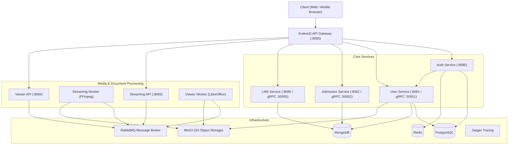

# Tarang (तरंग)

[](https://nextjs.org/)
[](https://react.dev/)
[](https://go.dev/)
[](https://www.docker.com/)
[]()

**Tarang** is an open, high-performance, and accessible educational operating system and learning management platform. Engineered with an event-driven Go microservices backend and a modern Next.js 15 frontend, Tarang provides scalable education delivery across 22 scheduled Indian languages, complete with real-time video streaming, interactive document viewers, and an end-to-end admissions pipeline.

---

## Highlights & Capabilities

### 🌐 Universal Multilingual Accessibility
- **22 Indian Languages**: Native localization with dynamic in-app language switching and locale normalization.
- **Inclusive UX**: Integrated high-contrast mode, text scaling, speech synthesis, and screen-reader optimizations.

### 🎓 Learning Management System (LMS)
- **Adaptive Video Player**: Multi-bitrate DASH/HLS streaming powered by Shaka Player, featuring chapters, auto-generated posters, and quality selectors.
- **Interactive Curriculum**: Live topic comment threads, rich discussion feeds, and downloadable topic resources.
- **Modular Course Editor**: Intuitive course creation with drag-and-drop syllabus reorganization and bulk media ingestion.

### 📝 Admissions & Application Engine
- **Program Builder**: Configurable admission intake cycles with dynamic eligibility criteria, application fees, and deadlines.
- **Draft Auto-Save**: Debounced background persistence for multi-stage applicant forms to prevent data loss.
- **Application Review Drawer**: Streamlined administrative applicant verification with status management and history tracking.

### 📄 Multi-Format Document & Media Viewer
- **Unified Previewer**: Instant in-browser rendering for PDFs (PDF.js), Jupyter Notebooks (`.ipynb`), LaTeX formulas (`.tex`), Markdown, Code files (Monaco Editor), Images, and ZIP archives.
- **Background Transcoding**: Asynchronous document conversion via LibreOffice and video transcoding with FFmpeg.

### 🔐 Enterprise Security & Identity
- **Authentication**: JWT authentication with refresh token rotation and Redis session management.
- **Multi-Factor Auth**: Time-based One-Time Passwords (TOTP) and passwordless WebAuthn (Passkeys / Biometrics).
- **Data Protection**: Argon2id password hashing and Application-Level Encryption (ALE) for sensitive profile records.
- **Identity Verification**: Built-in DigiLocker / KYC sandbox integration for institutional verification.

---

## System Architecture



---

## Repository Structure

```text
Tarang/
├── backend/
│   ├── cmd/                    # Administrative and setup CLI commands
│   ├── config/                 # KrakenD API Gateway and Prometheus configuration
│   ├── proto/                  # Protocol Buffers definitions (User, LMS, Admissions)
│   ├── services/
│   │   ├── admission/          # Admissions management & draft service
│   │   ├── auth/               # Authentication, MFA, and WebAuthn service
│   │   ├── gateway/            # Custom HTTP gateway routes and middleware
│   │   ├── lms/                # Course creation, topics, and comment service
│   │   ├── notification/       # Async email (SES) and SMS (MSG91) dispatcher
│   │   ├── streaming-api/      # Video upload and stream ingestion API
│   │   ├── streaming-worker/   # FFmpeg DASH/HLS transcode queue worker
│   │   ├── user/               # Profile, KYC, and institution RBAC service
│   │   ├── viewer-api/         # Document viewer orchestration API
│   │   └── viewer-worker/      # LibreOffice and LaTeX document transcode worker
│   ├── shared/                 # Shared logging, crypto, queue, and database packages
│   ├── docker-compose.yml      # Local orchestration for all backing services
│   └── Makefile                # Developer build and migration automation
│
└── frontend/
    ├── src/
    │   ├── app/                # Next.js App Router (pages, dynamic routes, layouts)
    │   ├── components/         # Reusable UI primitives (viewer, navbar, cards)
    │   ├── contexts/           # Global React state (Auth, Accessibility, Toast)
    │   ├── data/               # Static configuration and gazetteer dataset
    │   ├── features/           # Domain feature modules (admission, lms, profile, auth)
    │   ├── hooks/              # Custom React utility hooks
    │   ├── lib/                # API clients and data normalization helpers
    │   ├── styles/             # Modular CSS design system and variables
    │   └── utils/              # Formatting, storage, and validation utilities
    ├── package.json
    └── next.config.mjs
```

---

## Services & Ports Reference

| Service | Protocol / Port | Purpose |
| :--- | :--- | :--- |
| **Frontend** | HTTP `:3000` | Next.js 15 Web Application |
| **API Gateway** | HTTP `:8000` | KrakenD unified endpoint gateway |
| **Auth Service** | HTTP `:8080` | Authentication, JWT, TOTP, and Passkeys |
| **User Service** | HTTP `:8081` / gRPC `:50051` | Profiles, KYC sandbox, institution directory |
| **Admission Service** | HTTP `:8082` / gRPC `:50052` | Programs, drafts, application submissions |
| **Streaming API** | HTTP `:8083` | Video upload and presigned URL coordination |
| **Viewer API** | HTTP `:8084` | Document preview and conversion coordination |
| **LMS Service** | HTTP `:8085` / gRPC `:50055` | Courses, curriculum, discussions, resources |
| **PostgreSQL** | TCP `:5432` | Relational storage for Auth, User, and Media jobs |
| **MongoDB** | TCP `:27017` | Document store for LMS topics and application drafts |
| **Redis** | TCP `:6379` | Session revocation, caching, and rate limiting |
| **RabbitMQ** | AMQP `:5672` / Admin `:15672` | Asynchronous processing queue |
| **MinIO** | S3 API `:9000` / Console `:9001` | S3-compatible asset and media storage |
| **Jaeger** | UI `:16686` | Distributed OpenTelemetry tracing |

---

## Getting Started

### Prerequisites
- [Node.js](https://nodejs.org/) (v20+ recommended)
- [Go](https://go.dev/) (v1.25 or v1.26)
- [Docker](https://www.docker.com/) & Docker Compose

### 1. Clone the Repository
```bash
git clone https://github.com/Aaloktejs24/Tarang.git
cd Tarang
```

### 2. Start the Backend Infrastructure
The backing services and databases can be launched using Docker Compose:

```bash
cd backend
cp .env.example .env # configure secrets if needed
docker compose up -d
```

To run database migrations:
```bash
make migrate-up
```

### 3. Start the Frontend Application
In a separate terminal window:

```bash
cd frontend
npm install
npm run dev
```

Visit [http://localhost:3000](http://localhost:3000) to view the application in your browser.

---

## Testing & Verification

### Frontend Build & Lint
```bash
cd frontend
npm run build   # Validates types, routes, and creates production bundle
npm run lint    # Runs ESLint checks
```

### Backend Build & Lint
```bash
cd backend
go build ./...  # Verifies compilation across all microservices
golangci-lint run ./... # Runs Go linting checks
```

---

## License

This project is licensed under the MIT License. See the [LICENSE](LICENSE) file for more information.
